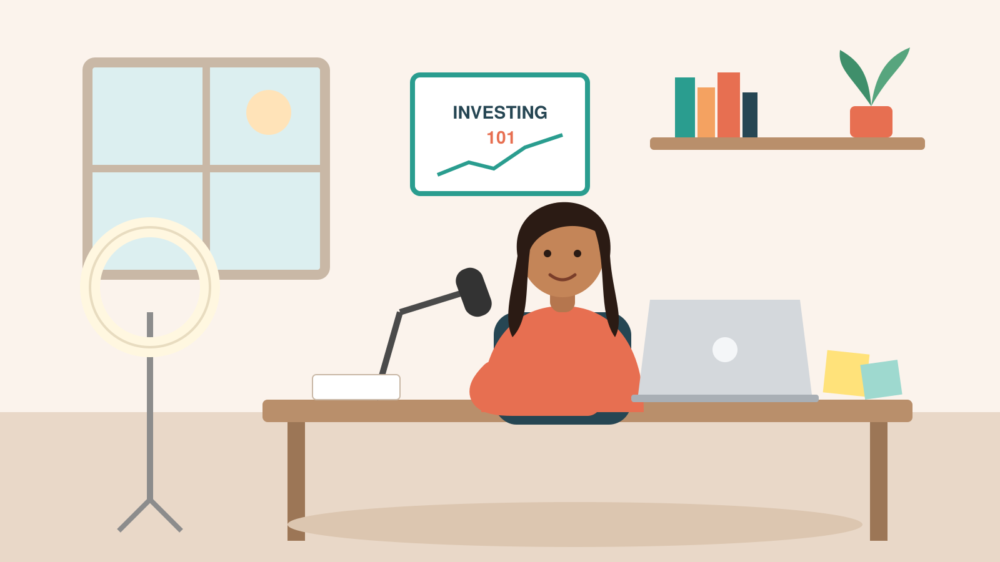

# Spec 01 — Product Brief: Lesson Studio

## 1. Description
A studio that turns what a teacher knows and already has (notes, readings, voice memos, slides) into finished teaching material for a specific audience, planned with them, grounded in their sources, and produced with professional teaching and production craft built in.

**The insight**

Generative media tools can make a beautiful clip. But an educator doesn't need a clip. They need a *lesson*: the right sequence, the right examples, accurate claims, sized to their audience and time slot, in a style that looks professionally made.

Today's tools assume two kinds of expertise most educators don't have:
- **AI expertise:** knowing how to prompt, which model to use, how to iterate.
- **Content production expertise:** knowing how to structure a video, pace narration, design a slide, choose a visual.

Lesson Studio brings the best practices of both to the educator **without asking them to make those choices.** The educator talks about teaching. The product handles production.

## 2. Hero personas and JTBD (built end to end)

### Hero A — Maya, educational content business

- Runs a personal-finance education business: YouTube + Instagram explainers that funnel to a paid course on a course platform.
- **Job:** "Turn my outline and a 5-minute voice memo into a 2–3 minute narrated explainer on *how index funds work*, that looks like mine, that I can post this week."
- **Emotions:** time pressure (posts 2x/week, does it all herself); fear of looking generic or "AI slop" to her audience; credibility (finance claims must be accurate); not a video editor and doesn't want to become one.
- **Success for her:** a publishable video in under an hour of her time, in her colors and voice, with no factual errors.
- **Output:** narrated explainer video (16:9, 2–3 min) + captions + thumbnail.

### Hero B — Dr. Elena Ortiz, university lecturer

- Teaches intro biology to ~200 first-year students. Lectures are live; she reuses and updates decks each term.
- **Job:** "Build my 50-minute lecture deck on *photosynthesis* from my notes and two assigned readings, with visuals that make the chloroplast click, and a couple of short clips I can play in class."
- **Emotions:** accuracy anxiety (students will repeat what she shows); academic integrity (wants citations on slides); time (it's Sunday night, lecture is Monday); wants control (will edit every slide); not a designer.
- **Success for her:** a deck she'd actually present after light edits, with speaker notes, citations, and 2–3 embedded clips.
- **Output:** slide deck (16:9) with speaker notes, per-slide citations, embedded images and short clips; export to PDF.

## 3. Design principles
1. **Design for educators who are neither AI experts nor content creators.** No prompts, no model pickers, no budget settings, no design decisions required. Every production choice has an expert default made by the system. The educator can change anything, but never has to.
2. **Talk teaching, not production.** The product asks about audience, goals, and time, never about models, credits, resolutions, or shot types.
3. **The teacher approves a teaching plan, not a production spec.** The plan reads like a lesson outline a colleague would write. Production details stay out of sight.
4. **Plan before producing.** Nothing is produced until the teacher approves the plan. Final-quality media is produced only after they approve a preview.
5. **Show your sources, and let the teacher choose what is cited.** Every slide shows where its facts came from. Anything not backed by the teacher's sources is flagged for them to confirm, never silently included. Private material (notes, voice memos) shapes the lesson but is never shown to viewers unless the teacher turns it on.
6. **Studio, not chat.** Layout inspired by Slides/Figma/Canva: left = course & lesson tree, center = canvas, right = assistant panel. The assistant speaks in the panel and inline cards, not a chat transcript.
7. **Cost discipline is the system's job.** The system works within an internal spend envelope per lesson and chooses cheaper visuals wherever they teach equally well. Costs are tracked in an internal ledger, never shown to or decided by the teacher. The same holds for the shared link: spending caps per access code and for the whole site are enforced by the system, never surfaced as numbers.
8. **Drafts, not decisions.** Every plan and preview is a draft the teacher can change three ways: edit it directly, describe the change in plain language, or say it out loud. Earlier drafts are kept, and nothing is final until the teacher finishes.
9. **Know the course, not just the lesson.** The system remembers what earlier lessons in a course covered, so it never asks what students already know when it can tell, and it suggests recaps where they help.

## 4. Core concepts
| Concept | What it is | Who chooses |
|---|---|---|
| **Course** | A container for related lessons, with its own settings: default audience, starter, template, guidelines and course preferences. Knows what its earlier lessons covered | Teacher creates; system fills defaults |
| **Lesson** | One teaching unit producing one artifact (explainer video or lecture deck; audio podcast later) | Teacher |
| **Starter** | What you're making and for whom: format, audience defaults, teaching structure, default guidelines (e.g. "Live lecture") | System suggests from the teacher's first answer; teacher can switch |
| **Template** | How it looks and sounds: layouts, typography, colors, motion style, narration voice. Curated, professionally designed. "Make from my brand" creates a custom one from a logo and colors | System picks to fit the Starter and audience; teacher can switch |
| **Audience** | Who's learning: level, prior knowledge, context | Inferred from teacher's answers; editable |
| **Source** | Material the teacher provides or approves. Each is either **cited** (shown to viewers on the sources card) or **private** (used to plan, never shown). Notes and voice memos default to private; readings and web pages default to cited | Teacher; system sets the default |
| **Guideline** | Rules content must follow (e.g. "never give individual investment advice") | Starter defaults + teacher additions |
| **Teaching plan** | The lesson outline the teacher approves: the story of the lesson, learning goals, and each slide with its narrative, its visual and its sources. Versioned as drafts; the system offers other angles on the story | System proposes; teacher edits, revises in plain language or by voice, and approves |
| **Artifact** | Produced output: video, deck, images, clips, narration, captions, exports | System |
| **Preferences** | How the teacher likes their material: tone, citation style, and habits like shorter bullets or real photos over illustrations. Two levels: **general** (in Settings) and **course** (in that course's settings), where a course preference overrides a general one. Learned from edits and answers, always editable. Never includes cost or model choices | System learns; teacher can edit, and their edits win |
| **Integrations, Scheduled tasks** | Connect drives/course platforms; recurring work like "draft next week's lecture every Friday" | Visual only in MVP |

## 5. Hero flows

### Flow A — Maya (explainer)
1. Home → "What are you teaching?" → she types "how index funds work, for my course audience". System suggests Starter "Detailed explainer" and a Template made from her brand.
2. **Add sources:** paste outline, upload voice memo, add one URL. The assistant summarizes each and flags gaps ("You don't explain expense ratios. Add a source, or I can draft it from general knowledge and mark it for you to check"). Her outline and voice memo are private by default; the Investor.gov page is cited.
3. **Plan:** assistant asks up to 3 quick questions as tappable choices (who it's for, how long, tone), each with a default. Proposes Draft 1 of the teaching plan: the story of the lesson, learning goals, and a slide-by-slide outline with the narrative and the visual for each.
4. **Shape the plan, then approve.** She can edit any slide directly, ask for a change to one slide, explore other angles on the story, or type or dictate a note ("punchier hook, add an example about fees") to get Draft 2. Changed slides are marked and earlier drafts are kept.
5. **Preview:** a draft video plays with real narration, diagrams and draft visuals. For any slide she can edit the narrative (that slide alone is re-recorded in the same voice) or change the visual (describe what to change and get a new version, switch between versions, or use her own image or clip).
6. **Approve preview.**
7. **Final:** video, captions and thumbnail saved to the course. She chooses which sources appear on the sources card at the end, or leaves the card out.

### Flow B — Dr. Ortiz (deck)
1. Home → "Week 6 photosynthesis lecture for BIO 101" → Starter "Live lecture", Template "University classic".
2. **Add sources:** her notes (doc), two readings (PDF). Assistant extracts key concepts, figures, and quotable passages with page references.
3. **Plan:** the assistant already knows what BIO 101 covered in Weeks 4 and 5, so it doesn't ask; it suggests opening with a short ATP recap from Week 5, which she can add or skip. Quick questions cover lecture length and where students usually get stuck. Proposes Draft 1 of the outline: sections, slide list with key points, visuals, citations, speaker notes, where clips go.
4. **Shape the outline, then approve.** Same tools as Maya: edit any slide, explore other angles ("follow one carbon atom", "start from a misconception"), or talk through her own outline and let the assistant turn it into slides.
5. **Preview:** full deck with images, draft clips and citations.
6. **Approve preview** after editing text inline, editing speaker notes, or making a new version of any slide's visual (or using her own figure).
7. Final clips, PDF export, saved to the course.

## 6. Screens
0. **Enter:** one field for the access code, shown before anything else. After a valid code the visitor lands on Home in their workspace.
1. **Home:** "What are you teaching?" input, Starter cards, recent lessons.
2. **Course view:** lessons list and **Course settings**: defaults (starter, audience, template), guidelines, course preferences, scheduled work.
3. **Lesson studio (one screen, stage stepper):** `Sources → Plan → Preview → Final`. Left: sources (each with a cite/private switch). Center: canvas for the stage, with a draft banner, Edit / Ask to change / Remove on every slide, and Edit / Dictate / Explore angles on the story. Right: assistant panel ("Tell me what to change" with dictation, questions, suggestions, warnings, plain-English activity). Preview panel: Narrative (edit and re-record one slide) and Visual (versions, new version, use my own).
4. **Templates gallery:** curated templates + "Make from my brand".
5. **Settings:** general Preferences (real: what the system has learned, each item editable or removable, noting that course preferences override them), Integrations (icons, visual only), Scheduled tasks (visual only).
6. **Lab (internal, separate app):** access codes (create, label, cap, revoke), usage per code (lessons made, how far each got, spend), site spend against the limits with pause and resume, cost ledger, evals, and a Model bakeoff view (cost vs quality per task, with the chosen model marked). Never linked from the educator UI.
7. **Top bar on every screen:** "Try the guided demo" switches into the guided demo; inside it, a banner says it's the guided demo and offers "Back to my lessons".

## 7. MVP scope (functional requirements)

| Area | Real | Mocked / visual only |
|---|---|---|
| Starting a lesson | Home topic box and Starter cards create a real lesson in the visitor's workspace (a first course is created on the first lesson); Sources → Plan → Preview → Final runs live | Starters marked "Coming soon" |
| Source Intake | Paste text, upload PDF/TXT/MD, URL text fetch; summary, key concepts, gap detection | Gated-content access, clip extraction from reference video, voice memos (guided demo only; live mode has no speech-to-text in the MVP) |
| Planning | Fully real (LLM): structured plan, clarifying questions, plan drafts, revise from a plain-language note (whole plan or one slide), three story angles, recap suggestion from earlier lessons in the course | Dictation (speech to text) uses a fixture transcript |
| Creation: deck | Slides rendered in React from plan + template; images via a video/image generation API; up to 2 short clips per lesson; new visual versions per slide; upload your own image; PDF and PPTX export | Clips beyond the per-lesson limit fall back to stills |
| Creation: explainer | Narration (TTS) with per-slide re-recording; in-browser player assembling narration and slide visuals; up to 2 short clips per lesson; new visual versions per slide; upload your own image or clip; sources card built from cited sources only | Downloadable MP4 (server-side render, later) |
| Concepts | Course (with course settings and knowledge of earlier lessons), Lesson, Starter, Template, Audience, Source (cited or private), Guideline, Artifact, Plan (with drafts), Preferences (general and course level). Starters for the two heroes: "Detailed explainer" and "Live lecture" | Integrations, Scheduled tasks. Other Starters shown as cards on the home screen (each pre-fills format, audience, structure and guidelines): **45-second explainer for social** (a dense idea, made simple, vertical, for a lay audience); **Study recap** (at-home study sheet and a 60-second recap of a lesson); **Training visual aid** (visual aids and scenario walk-throughs for live training); **Podcast explainer** (an audio file to learn or review concepts on the go; audio format is post-MVP) |
| Cost ledger & evals | Cost events logged from day one | Lab app is a separate build |

## 8. Non-functional requirements

### Guarantees (verified in the Lab app)
- **Cost observability:** every paid call is logged with lesson, model, units and outcome, and spend stays within each lesson's internal limit.
- **Quality regression:** evals run on every prompt, model, or routing change, and a drop in grounding or plan quality blocks the release.
- **Teacher-facing language:** no cost, credit or model names, and no production jargon, ever reach the teacher.
- **Reliability:** one failed generation never blocks a whole lesson, and the guided demo always plays end to end.
- **Privacy:** each workspace's sources are visible only inside that workspace, and API keys exist only in server settings.
- **Spend safety:** no paid call runs unless the spend gate allows it (per-code cap, daily site cap, total site limit), and every paid call is logged.

### Access and modes on the shared link
- **Access code required.** The link opens an Enter screen; nothing else is reachable without a valid code. The owner creates **one code per recipient** in Lab, each with a label (e.g. "Runway, hiring manager").
- **One workspace per code.** A code's lessons, sources, preferences and course history live together and follow the code across devices. A forwarded code shares that workspace and its cap.
- **Live mode is the default.** Visitors start from scratch with their own topic and sources; planning, revisions and media are real, within media caps: images, diagrams and narration, plus up to 2 short clips per lesson.
- **Guided demo is optional,** from the top bar. It opens a fresh copy of the Maya and Dr. Ortiz seed (per code, with Reset), serves all media from the demo cache, makes zero live calls and doesn't count toward any cap.
- **Spending limits (internal, owner-set in Lab):** per code (default $15), per day for the whole site ($40), and a total for the site (starting at $200). At 75% of the total, Lab shows a warning. At the total, live generation pauses for everyone: visitors see a plain message ("Lesson Studio isn't making new media right now") and are offered the guided demo. Raising the limit in Lab resumes live mode immediately.

## 9. Out of scope (MVP)
No accounts or sign-in (access codes only), no collaboration. No real integrations. One language. 16:9 only. No timeline editor. No publishing. No audio-only (podcast) output. No user-facing cost, budget, or model controls.

## 10. Success metrics
- Time from "new lesson" to approved plan (target: under 10 minutes).
- Plan approval rate without major edits.
- Grounding rate: share of claims traced to a source.
- New-version and re-record rate per slide (quality signal).
- How teachers change drafts: direct edits vs plain-language revisions vs dictation, and how many drafts before approval.
- Week-2 return: did the educator make a second lesson?
- Internal: cost per finished minute (explainer) / per deck, cost per approved plan, and share of spend on motion.

## 11. Build sequence
0. **Mock first (done, locked Oct 26):** a clickable prototype of every screen and both hero flows, with fixture content, reviewed in two rounds of feedback. It is the visual spec the build matches.
1. Shell + seed data + stub agents, matching the locked mock.
2. Real Planning agent.
3. Real Source Intake (text/PDF/URL).
4. Creation: deck path.
5. Creation: explainer preview.
6. Deploy the link with access codes, live mode by default and the guided demo as an option.
7. Lab app (ledger + evals).
8. **Model bakeoff:** compare open models against Claude per task (extraction, planning, self-check, preference learning) on the same golden set; set routing and cascades from the results.
9. **Model router (conditional):** build only if the bakeoff shows a cheap model wins on easy requests but loses on hard ones. Start with simple rules; a learned router comes later, from real usage data.
