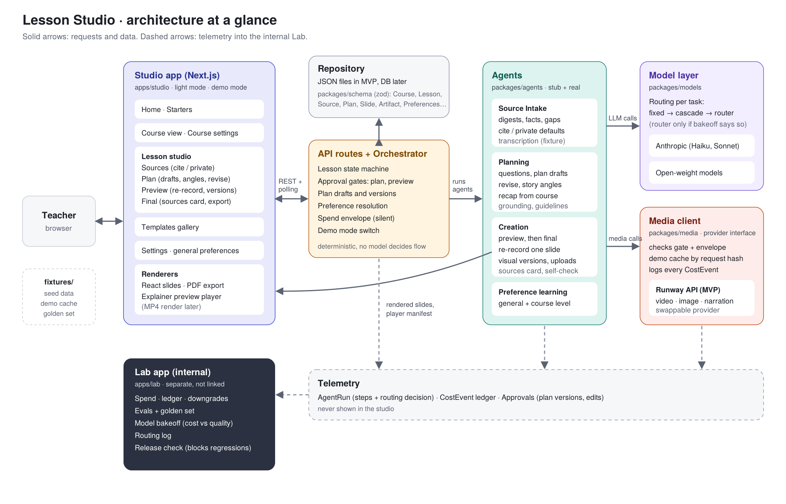

# Spec 03 — Agent Contracts and Architecture

> Every agent is a function with a typed input and output (schemas from Spec 02), a stub implementation that returns fixtures, and a real implementation. The UI only ever talks to the **orchestrator**, never to an agent directly. Stubs must pass the same schema validation as real agents.

## Architecture at a glance



| Part | Folder | What it owns |
|---|---|---|
| Studio app | `apps/studio` | Every teacher-facing screen, plus the renderers (React slides, PDF export, explainer preview player) |
| API routes + Orchestrator | `apps/studio/app/api`, `packages/orchestrator` | Lesson state machine, approval gates, plan drafts, preference resolution, spend envelope, demo mode |
| Repository + schema | `packages/schema`, `data/` | Zod types (Spec 02) and JSON-file persistence for the MVP |
| Agents | `packages/agents` | Source Intake, Planning, Creation, Preference learning (stub and real) |
| Model layer | `packages/models` | One interface over Anthropic and OpenAI-compatible open-weight models; per-task routing |
| Media client | `packages/media` | One interface over the media provider (Runway API in the MVP); gate and envelope checks, demo cache, cost logging |
| Lab app | `apps/lab` | Internal only: spend, ledger, evals, model bakeoff, routing log |
| Fixtures | `fixtures/` | Seed data, demo cache, golden set |

The diagram source is `images/architecture.svg`; edit it there and re-render the PNG.

## 0. Architecture decisions
1. **Deterministic orchestrator, specialist agents.** A plain state machine (Spec 02 §4) decides *which* agent runs and *when*. Agents decide *what* to produce. Reason: predictability, cost control, and gates a model can't skip.
2. **Structured output only.** Every LLM call returns JSON validated by zod. Use the provider's JSON mode or constrained decoding where available (open-model hosts vary). On validation failure: one automatic repair attempt, then escalate per routing (0.3b), then fail the AgentRun with `needs_user`.
3. **Cheapest model that passes evals.** All LLM calls go through `packages/models` with two providers: Anthropic, and OpenAI-compatible (covers most hosted open-model platforms). A per-task routing config maps each task to a model. MVP defaults:

   | Task | Default | Bakeoff candidates |
   |---|---|---|
   | Source extraction | `claude-haiku-5-5` | Small and mid-size open models |
   | Planning (plans, revisions, angles, recap) | `claude-sonnet-5-5` | Large open models; Haiku |
   | Preview self-check | `claude-haiku-5-5` | Small open models |
   | Preference learning | `claude-haiku-5-5` | Small open models |
   | Transcription (voice memos, dictation) | fixture in MVP | Any speech-to-text provider |

   Specific open models are chosen at bakeoff time, not fixed here. Model IDs and prices live only in the config.

   3a. **Routing levels, adopted in order and only when evidence supports them:** fixed per task (MVP) → cascade (cheap model first, escalate when schema or grounding checks fail) → router (picks a model per request from format, source tokens, source count, conflicting sources; built only if the bakeoff shows a difficulty split; rules first, learned later).

   3b. **Escalation on failure:** after one failed repair, retry once on the next model up (e.g. Haiku → Sonnet, open model → Claude) before `needs_user`.

   3c. **Every routing decision is logged** on the AgentRun. Any change to models or routing must pass the eval suite before release.
4. **Media calls go through one client** (`packages/media`) that checks the lesson status allows spending, checks the internal spend envelope, serves from cache in demo mode, logs a CostEvent for every call, and polls async tasks.
5. **Everything is logged.** Each agent run writes an AgentRun with steps. Each paid call writes a CostEvent.
6. **No production choices are pushed to the teacher.** Models, quality tiers, visual types, spend and template details are system decisions. Agents ask only about teaching (audience, goals, length, tone, emphasis). Cost, credits and model names never appear in teacher-facing text.
7. **Drafts, not decisions.** Every change to a plan produces a new plan version; nothing is overwritten. Every visual version is kept. The teacher can always go back.
8. **One unit: the slide.** Decks and explainer videos are both made of slides (Spec 02 `Slide`). Teacher-facing text never says "scene".

### Media provider config (MVP provider: Runway API; verify model IDs and prices in its docs before live runs)
| Use | Model | Planning cost assumption |
|---|---|---|
| Draft motion clip | Gen-4 Turbo | 5 credits/sec |
| Final motion clip | Gen-4.5 | 12 credits/sec |
| Still image | Gen-4 Image Turbo (draft), Gen-4 Image (final) | ~8 credits/image (verify) |
| Narration | ElevenLabs Multilingual v2 via Runway API | measure; record actual |

Clip length 5s default (allowed 2–10s). 16:9, 720p.

### Orchestrator API (server routes)
Sources
- `POST /api/lessons/:id/sources` → Source Intake on new sources
- `PUT  /api/sources/:id/visibility` `{ visibility: "cited" | "private" }`

Plan
- `POST /api/lessons/:id/plan` → Planning (first draft, or with answers to questions)
- `POST /api/lessons/:id/plan/revise` `{ text, via: "typed" | "dictated", slideId? }` → Planning revision → new plan version
- `PATCH /api/plans/:id/slides/:slideId` `{ narrative?, visual?, bullets?, speakerNotes? }` → direct edit → new plan version (`changeReason: "teacher_edit"`)
- `PATCH /api/plans/:id/story` `{ story? , angleId? }` → direct edit or switch angle → new plan version
- `POST /api/plans/:id/recap` `{ decision: "added" | "skipped" }`
- `GET  /api/lessons/:id/plans` → all drafts (for "Earlier drafts")
- `POST /api/lessons/:id/plan/approve` → Approval(plan) → `generating_preview` → Creation(preview)
- `POST /api/transcribe` (audio) → text, used by every Dictate button (fixture in MVP)

Preview and final
- `POST /api/lessons/:id/slides/:slideId/rerecord` → Creation re-records that slide's narration only
- `POST /api/lessons/:id/slides/:slideId/visual-version` `{ note? }` → Creation makes a new visual version
- `POST /api/lessons/:id/slides/:slideId/visual-upload` (file) → stores a teacher upload as a new version
- `PUT  /api/lessons/:id/slides/:slideId/visual-version/:n` → choose a version
- `POST /api/lessons/:id/preview/approve` → Approval(preview) → Creation(final)
- `PUT  /api/lessons/:id/sources-card` `{ show, sourceIds }`

Preferences and polling
- `GET/PUT /api/preferences` (general) · `GET/PUT /api/courses/:id/preferences` (course)
- `GET /api/lessons/:id/events` → AgentRun steps + status (polling; no websockets in MVP)

---

## 1. Source Intake Agent

**Purpose:** Turn raw materials into structured, citable knowledge, set sensible cite/private defaults, and tell the teacher what's missing.

**Trigger:** New Source added, or Planning requests sources for a gap.

**Input**
```ts
{ lesson: Lesson, audience: Audience, sources: Source[], request?: { kind: "find_for_gap", gap: string } }
```
**Output**
```ts
{
  digests: { sourceId: string, digest: SourceDigest }[],
  visibilityDefaults: { sourceId: string, visibility: "cited" | "private" }[],
  coverage: { objective: string, covered: boolean, bySourceIds: string[] }[],
  gaps: { gapId: string, description: string, severity: "blocking" | "nice_to_have",
          suggestion: { kind: "ask_user_for_source" | "suggest_source" | "use_general_knowledge_flagged", detail: string } }[],
  suggestedSources: Source[]   // origin: "agent_suggested", approvedForUse: false, visibility: "cited"
}
```
**Tools**
- `extract_text(file)`: real for txt/md/pdf (`pdf-parse`).
- `transcribe(audio)`: voice memos and video; **fixture transcript in MVP**.
- `fetch_url(url)`: real (`@mozilla/readability` + `jsdom`).
- `search_reference(query)`: **mocked**; fixture candidates (e.g. an open textbook section).
- `extract_clip(sourceId, start, end)`: **mocked**; cached clip.

**Policy**
- Chunk long sources (~6k tokens per chunk); digest each with the `source_extraction` model; merge.
- Every `quotableFact` must have a `locator`. No locator → drop the fact.
- Visibility defaults: notes, pasted text, voice memos, slides, videos and prior lessons → `private`; PDFs, web pages and suggested readings → `cited`. The teacher's choice always wins and is never changed by the system.
- Never mark an agent-suggested source as approved. It shows as a card: "Use this source?" → Approval(gate: suggested_source).

**Failure handling:** Unreadable file → Source.status `failed` with a plain-English reason ("This PDF is a scanned image; upload a text PDF or paste the text"). URL blocked → same pattern.

**Stub:** fixture digests for seed sources and one gap.

**Eval hooks:** facts-with-locator rate; gap detection vs a labeled set; digest faithfulness (judge: does every fact appear in the source?).

---

## 2. Planning Agent

**Purpose:** Act like a great teaching assistant: clarify, propose a plan the teacher can approve in one read, and revise it as often as they like, within the guidelines.

**Trigger:** Sources ready; answers to questions; a revision note (typed or dictated, whole plan or one slide); a request for other angles.

**Input**
```ts
{
  mode: "draft" | "revise" | "angles",
  lesson: Lesson, starter: Starter, template: Template, audience: Audience, guidelines: Guideline[],
  preferences: { general: Preferences, course?: Preferences },   // resolved per Spec 02 §5
  courseKnowledge: CourseKnowledge,
  digests: { sourceId: string, digest: SourceDigest }[],
  answers?: { qId: string, answer: string }[],
  currentPlan?: TeachingPlan,
  revision?: { text: string, via: "typed" | "dictated", slideId?: string }
}
```
**Output** (one of)
```ts
{ kind: "questions", questions: ClarifyingQuestion[] }          // max 3; only if they change the plan
| { kind: "plan", plan: TeachingPlan, changedSlideIds: string[], summary: string }  // summary is teacher-facing: "I changed slides 3 and 6…"
| { kind: "needs_sources", gaps: string[] }                      // delegates to Source Intake
```

**Policy**
1. **Clarify sparingly, about teaching only.** At most 3 multiple-choice questions, each with a default, only when the answer changes the lesson. **Never ask what students already know when `courseKnowledge` answers it.** If skipped, use defaults and record them in `plan.assumptions` ("I assumed…").
2. **Teach, don't summarize.** Follow `starter.teachingStructure`. Explainer default arc: hook → context → concept(s) → example → misconception → recap → CTA. Deck: sections mapped to learning objectives; one idea per slide; a check-for-understanding `question` slide per section.
3. **Three story angles, always.** Every plan carries `angles` (the current one plus two genuinely different ways to tell it, e.g. "Follow one carbon atom", "Start from a misconception"). Switching angle reorders and rewrites slides to match.
4. **Recap from the course.** If an earlier lesson in `courseKnowledge` covers a prerequisite for this one, propose a short `recap` (1–3 slides) built from that lesson, with `decision: "pending"`. Never insert it without the teacher choosing "Add".
5. **Revisions.** In `revise` mode, apply the note to the whole plan, or only to `revision.slideId` when set. Produce a new version with `parentPlanId`, set `changedInVersion` and `changeReason` on every changed slide, and leave untouched slides byte-identical. Direct teacher edits are applied by the orchestrator without the model, also as a new version.
6. **Ground every claim.** Each factual claim cites a `factId`. If none exists, rephrase as non-factual or mark `general_knowledge_flagged` (amber, for the teacher to confirm → `general_knowledge_checked`). Never output `unsupported` claims in an approved plan.
7. **Spend where motion teaches (system decision).** Cheapest visual type that teaches equally well; `generated_clip` only for processes, motion, scale or emotional hooks. Caps: ≤ 3 clips per lesson. Every slide has an internal `whyThisVisual` and a teacher-facing `visual`.
8. **Stay inside the spend envelope silently.** If over, downgrade the lowest-value motion slides (clip → still → diagram) and record each in `downgradesApplied`. Never mention cost.
9. **Guidelines and preferences.** Evaluate every guideline (`guidelineChecks`); a failing one blocks `awaiting_approval`, repair once, then surface in plain language. Apply resolved preferences (course over general).
10. **Template and voice.** Copy follows `template.voiceAndTone`; visual prompts include `template.visualStyle`, `template.motionStyle` and template colors.
11. **Length.** Explainer narrative ≈ 150 words/min, total within ±10% of target. Deck: ~1 slide per 1.5–2 min.
12. **Write for a teacher.** The plan reads like a colleague's lesson outline. No production jargon.

**Model:** routed by config (task `planning`). System prompt in `packages/agents/prompts/planning.md`; revision and angle prompts alongside it.

**Failure handling:** Schema failure → one repair → one escalation → `needs_user` ("I couldn't finish the plan, try again or shorten the sources."). Missing critical source → `needs_sources`.

**Stub:** fixture questions on first call; fixture Draft 1 (with angles and, for BIO 101, a pending recap) on second; fixture Draft 2 for any revision.

**Eval hooks:** schema validity; grounding rate; envelope adherence and downgrade rate; guideline pass rate; no-jargon check; "untouched slides unchanged" check on revisions; angle distinctness (judge); recap relevance (judge); rubric (pedagogy, audience fit, pacing, voice); approval-without-major-edit rate and drafts-before-approval.

---

## 3. Creation Agent

**Purpose:** Produce the lesson exactly per the approved plan, cheaply first and expensively only after approval, and let the teacher change any slide's narration or visual without redoing the rest.

**Trigger:** Plan approved (→ preview pass); a slide re-record, new visual version or upload; preview approved (→ final pass).

**Input**
```ts
{ lesson: Lesson, plan: TeachingPlan /* approved */, template: Template, sources: Source[],
  pass: "preview" | "final" | "slide",
  slideOp?: { slideId: string, op: "rerecord" | "visual_version" | "visual_upload", note?: string, uploadUri?: string } }
```
**Output**
```ts
{
  artifacts: Artifact[],
  assembled: { kind: "explainer_preview" | "explainer_final" | "deck_preview" | "deck_final", manifestUri: string },
  costSummary: { spentCredits: number, byOperation: Record<string, number> },   // internal, Lab only
  issues: { slideId: string, kind: "generation_failed" | "off_brief" | "envelope_reached", detail: string }[]
}
```

**Tools**
- `render_title_card`, `render_diagram`: local React/SVG render with the template, free.
- `generate_image(prompt, quality)`, `generate_clip(prompt, seconds, quality, imageRef?)`: media provider (async; poll).
- `generate_narration(text, voice)`: media provider TTS, voice from `template.narrationVoice`.
- `assemble_explainer(manifest)`: JSON manifest the in-browser player plays (slides, audio, captions, timings).
- `assemble_deck(manifest)`: React slide pages; `export_pdf` via headless print.
- `build_sources_card(sources, lesson.sourcesCard)`: only sources with `visibility: "cited"` that the teacher left on.

**Policy**
1. **Preview pass:** title cards and diagrams rendered; still images draft quality; clips on the draft model; narration generated (cheap and essential for review); captions from narration.
2. **Slide operations (during `preview_review`):**
   - `rerecord`: regenerate narration for that slide only, in the same voice; re-time captions for that slide.
   - `visual_version`: generate a new version of that slide's visual, using the optional `note` ("warmer colors, no needle"). Keep all versions; mark the new one `chosen`.
   - `visual_upload`: store the teacher's file as a new version with `origin: "teacher_upload"`, no generation.
   - Never touch other slides.
3. **Final pass:** regenerate only chosen generated visuals at final quality (clips on the final model). Reuse narration unless edited. Teacher uploads are used as-is. Explainer final also produces captions and a thumbnail (from the hook slide).
4. **Image-to-video first.** For clips, make a branded still, then animate it.
5. **Spend-envelope guard (silent).** Before each paid call, check `spent + call ≤ limit`. If not, use the next cheaper visual type, log `envelope_reached`, continue. More than 3 new versions on one slide switch to cheaper visual types.
6. **One retry per failed generation,** then a fallback (still or diagram). Tell the teacher only if the result visibly differs from the plan, in plain language.
7. **Citations travel with content.** Deck slides show citations in the footer; the explainer ends with a sources card built per the tool above, or none if the teacher turned it off. Private sources are never cited.
8. **Self-check (cheap):** after preview, a `self_check` model call per slide: does the visual still match the narrative and claims? Flag `off_brief`.

**Failure handling:** Media task fails or times out → retry once → fallback + issue. Never block the whole lesson on one slide.

**Stub / demo mode:** all media from `fixtures/cache/` by request hash; CostEvents written with `cached: true` and `originalCredits`.

**Eval hooks:** cost per finished minute / per deck; new-version and re-record rate per slide; fallback rate; `off_brief` rate; share of spend on motion.

---

## 4. Preference learning
- After each approval with edits, and after each plan revision, a `preference_learning` model call proposes updates from the edit log. A pattern must appear in at least 2 lessons before it's saved.
- **Scope:** a pattern seen only within one course becomes a course preference for that course; a pattern across courses becomes a general preference.
- Learned items are saved with `origin: "learned"` and an `evidence` line, and appear in Settings (general) or the course's settings (course), where the teacher can edit or remove them.
- `origin: "teacher"` items are never overwritten; removed values are never relearned.
- Resolution order for every agent: Template and Starter defaults → general → course → edits within the lesson.

## 5. Model bakeoff (Lab)
- **Golden set:** 15–20 EvalCases per task across both heroes, labeled easy/medium/hard, including hard cases (dense PDF, messy voice memo, conflicting sources, a vague revision note).
- **Metrics per model:** must-pass (schema valid on first try, grounding), repair rate, rubric score from a fixed judge, human spot-check on ~20% of cases, p50/p95 latency, credits per successful output including retries. Overall and by difficulty.
- **Decision rule, written before the run:** per task, the cheapest model that loses no more than 1 point on valid-first-try or grounding, with a rubric score within ~5% of the best. Recorded in BakeoffResult.
- **Outputs:** routing config per task, cascades where a cheap model is good but not reliable, and `routerRecommended` when results split by difficulty.
- **Scope:** LLM tasks only. Media and speech models are a separate, later bakeoff.

## 6. Handoffs
```
Teacher adds sources ─▶ Source Intake ─▶ digests + cite/private defaults ─▶ Planning
Planning ─needs_sources─▶ Source Intake (find_for_gap) ─▶ suggested source card ─teacher approves─▶ Planning
Planning ─questions─▶ choice chips ─answers─▶ Planning ─Draft N (+ angles, recap)─▶ Plan review
Plan review ─edit / revise note / dictate / switch angle / add recap─▶ Draft N+1  (loop)
Plan approved ─▶ Creation(preview) ─▶ Preview review
Preview review ─re-record / new visual version / upload─▶ Creation(slide)  (loop, one slide at a time)
Preview approved ─▶ Creation(final) ─▶ ready ─▶ CourseKnowledge updated ─▶ Preference learning
```

## 7. UI surfaces (teacher-facing; no cost, credits, model names, or "scene")
- **Assistant panel (right):** "Tell me what to change" (typed or dictated, with suggestion chips), plain-English activity, questions as choices, gap and suggested-source cards, "I assumed…" lines, "What students already know" with the recap suggestion, guideline notes.
- **Sources:** each source shows a **Cite in the lesson** switch with its current state in words ("Private: used to plan, never shown to viewers").
- **Plan canvas:** draft banner (Draft N, earlier drafts); the story with Edit / Dictate / Explore angles; slide cards with Narrative, Visual, sources, amber flags, a "Changed in draft N" badge, and Edit / Ask to change / Remove; Add a slide or section.
- **Preview:** player (explainer) or slide strip (deck). Side panel for the selected slide: **Narrative** (edit, then "Re-record this slide") and **Visual** (versions, "What should change?", Make a new version, Use my own image or clip). Banner: nothing is final until you finish.
- **Final:** download and share actions, lesson components, sources card switches (and "leave it out").
- **Settings:** general preferences. **Course view → Course settings:** defaults, guidelines, course preferences, scheduled work.
- **Lab app (internal, separate):** spend and ledger, downgrades, evals, model bakeoff, routing log, release check.
